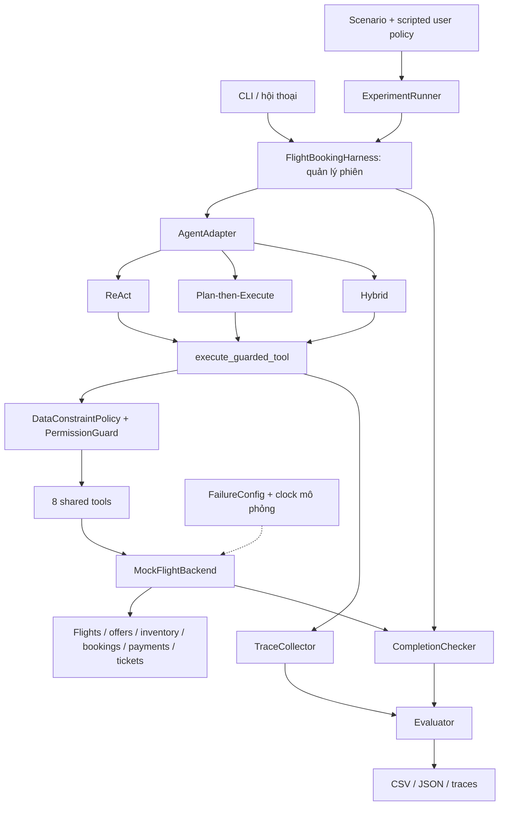
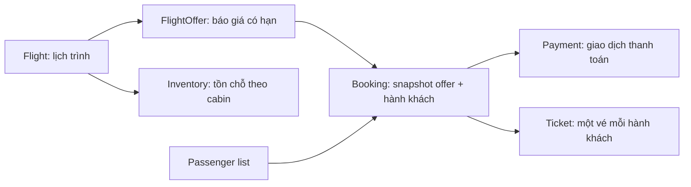
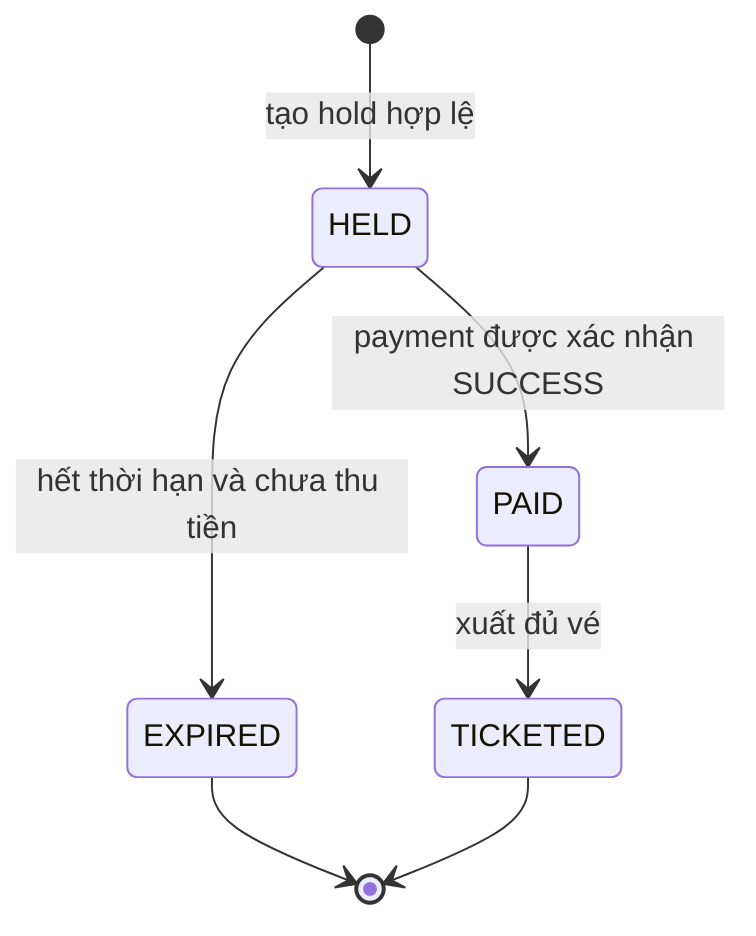
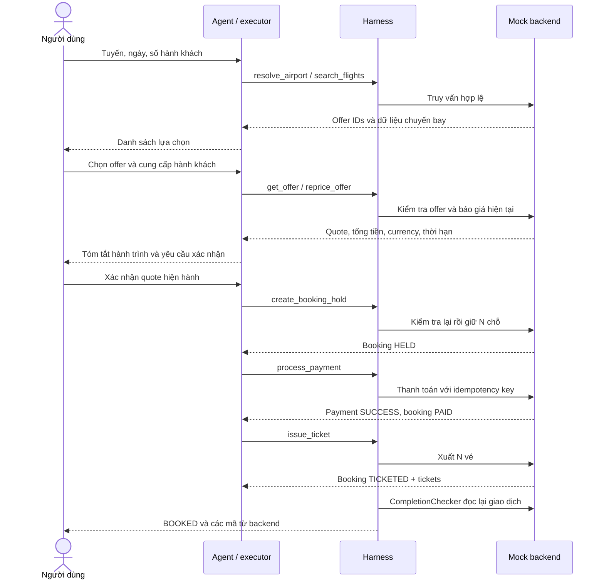
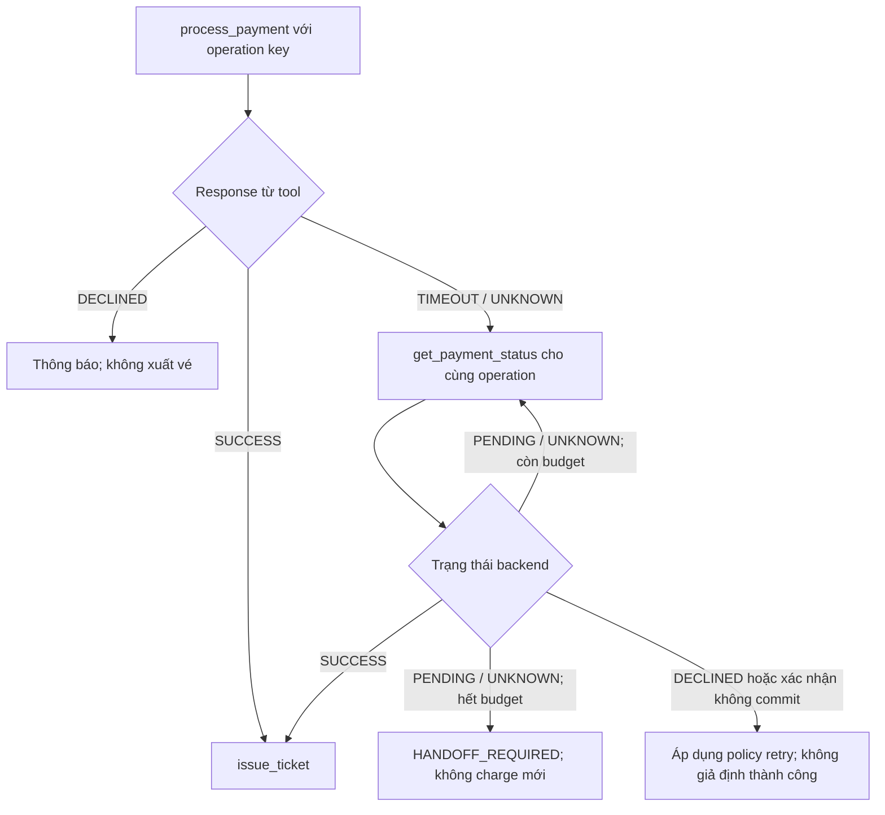

# Phân tích kiến trúc Flight Booking Agent Lab

Nguồn phân tích: [plan.md](./plan.md). Ngày phân tích: 05/10/2026.

**Refactor input hiện tại (06/10/2026):** Gemini cả ba pattern dùng chung structured `InputInterpreter` thay parser regex cho hội thoại tự nhiên. Proposals có literal evidence, full readback và lượt `áp dụng` trước commit; approval interpretation không phải quote consent. Search chỉ expose sort_by/limit, harness bind canonical constraints. Invalid request giữ accepted snapshot nhưng block business actions/rút approval; profile không sửa ngày bay. Model phân loại câu hỏi, host trả facts đã kiểm chứng. Fake giữ local grammar/legacy router. Hợp đồng hiện hành và giới hạn ở [spec mục 20](./implementation_spec.md#20-shared-input-interpretation-và-state-bound-search); các tiến độ A–G bên dưới là lịch sử, không phải benchmark sau refactor. Tests không thuộc benchmark được chạy offline/HTTP giả lập; không gọi Gemini thật hoặc chạy H.

Tài liệu này giải thích kiến trúc dự kiến, luồng xử lý, phạm vi use case và các quyết định cần làm rõ trước khi xây dựng. Tại thời điểm phân tích ban đầu, thư mục `FlightAgent` chỉ có kế hoạch. Vì vậy, “cover” trong các ma trận dưới đây có nghĩa là **thiết kế có thể hỗ trợ nếu được triển khai và kiểm thử đúng**; trạng thái đã triển khai được ghi riêng theo mốc.

Các mục ghi **Theo kế hoạch** diễn giải yêu cầu trong `plan.md`. Các mục ghi **Đề xuất** bổ sung hợp đồng triển khai hoặc xử lý khoảng trống; chúng không tự động mở rộng phạm vi đã chốt.

**Cập nhật 05/10/2026:** các quyết định người dùng bổ sung đã được cụ thể hóa trong [implementation_spec.md](./implementation_spec.md). Pricing nhóm, confirmation snapshot/version, typed constraints, clock, PaymentOperation, idempotency payload hash, PRE/POST transaction boundary, evaluation và one-shot failure đã có hợp đồng triển khai. Đọc specification này khi các nhận định “cần chốt” hoặc tên field gợi ý bên dưới không còn khớp; hợp đồng của các mốc chưa triển khai vẫn cần được xác nhận bằng implementation/tests.

**Tiến độ mốc A — hoàn thành 05/10/2026:** đã có domain models, simulated clock, seed (36 flights/54 offers), mock backend và demo search → reprice → hold → payment → ticket không cần LLM. Có 47 test của mốc A, gồm pricing nhiều người, confirmation, tồn chỗ, expiry và idempotency.

**Tiến độ mốc B — hoàn thành 05/10/2026:** đã có scoped one-shot failure rules, price change/sold-out/offer expiry, payment DECLINED/UNKNOWN/timeout-but-committed, inventory ledger và 11 nhóm backend invariants. Tổng bộ A+B có 89 test; bảy demo backend lỗi/recovery chạy không cần LLM.

**Tiến độ mốc C — hoàn thành 05/10/2026:** đã có tám LangChain guarded tools, schema/source/data/permission boundary, trusted user-turn confirmation sau quote presentation, harness-owned state/reducer, CompletionChecker đọc backend + trace, budgets, HandoffManager và ordered TraceCollector. Tổng bộ A+B+C có 176 test đạt, gồm 87 test bổ sung cho C; tám demo qua harness chạy không cần LLM. Có JSON export initial/backend/agent state, trace, completion và handoff để đối chiếu dữ liệu đã ghi. Demo vẫn dùng scripted user host, chưa có LLM/CLI hội thoại tự nhiên; parsing, adapter và ReAct thuộc D, scenario/evaluator/benchmark thuộc E–H. Xem [README.md](./README.md) để chạy và phân biệt snapshot export với durable persistence.

**Tiến độ mốc D — hoàn thành 05/10/2026:** có `BaseFlightAgent`/`AgentTurnResult`, conversation draft/messages/observed offers, parser local bảo thủ, trusted confirmation ingress, một ReAct LangGraph model → guarded tools → observation và CLI nhiều lượt. Pause/resume trong cùng process giữ booking/payment references và keys; sửa dữ liệu vẫn áp dụng PRE/POST boundary mốc C. CLI có state/backend/trace/completion/handoff, simulated advance, reset có acknowledgment và export thêm `conversation.json`. Tổng A–D **256 test đạt** (80 mới cho D), gồm multi-turn happy path, missing input, expiry, lỗi/recovery, model proposals trái phép, SDK round-trip qua transport giả và CLI subprocess. `fake` là test double, không phải LLM; chế độ OpenAI Responses đã nối nhưng chưa gọi hosted API thật. Ingress chỉ hỗ trợ grammar/JSON đã tài liệu hóa, chưa phải NLP tổng quát. E–H, durable recovery và benchmark chưa triển khai. Xem [README.md](./README.md).

**Tiến độ mốc E — hoàn thành:** catalog S01–S12 có schema machine-readable, scripted user policy dùng observed offers/quote và oracle đọc backend + ordered trace/checkpoints, không chấm lời assistant. S02/S10 dừng ở WAITING_INPUT/WAITING_CONFIRMATION; S07 FAILED đúng kỳ vọng vẫn PASS; các scenario còn lại tiếp tục đến BOOKED. Mọi episode dùng fresh backend/seed/clock/rules và cùng adapter/guard C. Có exerciser pattern-neutral, demo offline từng scenario và export 11 JSON (thêm scenario, scripted user, checkpoints, scenario result). Tổng A–E **360 test đạt**, gồm 104 test mới cho E, negative oracle/tampered evidence và CLI subprocess; compile/pip check đạt. S03 là alias parser local, S11 là duplicate delivery qua guard, không đánh đồng với năng lực suy luận/retry của LLM. Tại thời điểm nghiệm thu E, F/G, benchmark tổng hợp H, hosted LLM evaluation và durable recovery chưa triển khai; tiến độ F được ghi bên dưới. Xem mục 9.3 và [README.md](./README.md).

**Tiến độ mốc F — hoàn thành 06/10/2026:** `PlanExecuteFlightAgent` chạy LangGraph structured planner → declared-step executor, cùng adapter/user ingress và tám guarded tools C. Có `BookingPlan`/`PlanStep` forbid business arguments, runtime binding từ state, plan revision/cursor, REQUEST pause/resume, skip work đã commit và bounded invalidation/replan từ goal/error/previous plan/observed committed state. Timeout không lộ hidden backend SUCCESS; query operation cũ trước ticket. CLI và single-scenario demo chọn `--pattern react|plan_execute`, `--provider fake|openai`; F dùng Responses Structured Outputs, chưa gọi API thật. Tổng A–F **455 test đạt** (95 mới cho F), đủ S01–S12 qua cùng oracle, negative plan/schema/budgets, pause sau hold/paid giữ keys và không charge lại, SDK mock transport/refusal/provider errors, CLI/export. Compile/pip check đạt. G/H, durable recovery và hosted-model benchmark còn lại; xem mục 8.2 và [README.md](./README.md).

**Tiến độ mốc G — hoàn thành 06/10/2026:** `HybridFlightAgent` có read-only structured conversation router và explicit deterministic transaction/recovery LangGraph qua cùng adapter/guard C. Router chỉ CONTINUE/CLARIFY hoặc grounded proposal để host readback và actual user turn `áp dụng` duyệt; không có business tools, raw assistant claims, transaction steps, PII/keys/confirmation. Confirmation vẫn là NEW genuine turn sau quote display, không bị interpretation approval thay thế. Runtime graph chọn validate/reprice/confirm/hold/pay/query/ticket/completion từ observed state; stale quote/sold-out/expiry/read error có conditional recovery, UNKNOWN query operation cũ theo budget. Resume giữ held/paid work, không reprice locked quote hoặc charge lại; ambiguous input sau hold handoff. CLI/demo thêm `--pattern hybrid`. Tổng A–G **569 test đạt** (114 mới cho G), đủ S01–S12 qua cùng oracle, grounded interpretation/consent/invalid schema/budgets/faults/resume/CLI/SDK mocked transport. Compile/pip check đạt tại G; chưa gọi hosted API thật hoặc khẳng định NLP tổng quát. H và durable recovery còn lại tại thời điểm nghiệm thu G; tiến độ H ghi bên dưới. Xem mục 8.3 và [README.md](./README.md).

**Tiến độ mốc H — implement code 06/10/2026, chưa nghiệm thu runtime:** có `EpisodeEvaluator`, audit distinct committed transactions, actual invoke/usage telemetry, `ExperimentRunner` lặp ba pattern trên S01–S12 và CLI `app.benchmark`/`app.cli --benchmark`. Mặc định 108 episodes; model/backend mới từng episode, chung seed/clock/rules/tools/policy/budgets; xoay pattern order và đối chiếu environment hashes. Code xuất CSV/JSONL, raw per-episode evidence và summary có mẫu số/variance; token/cost thiếu metadata giữ unknown, bảng giá do user cấu hình. Có test code cho metrics/runner/CLI/SDK mock transport nhưng **không chạy bất kỳ test, benchmark hoặc API** theo yêu cầu. Chỉ kiểm tra cú pháp tĩnh; chưa có results mới hoặc kết luận so sánh LLM. Các số test PASS A–G phía trên là lịch sử, không được re-run sau H. Durable restore/hosted validation còn lại; xem README và specification mục 18.

**Provider hiện tại — Gemini (06/10/2026):** provider thật đã thay bằng `ChatGoogleGenerativeAI` / Gemini Developer API cho cả ba pattern, CLI/scenario/H benchmark nhận `fake|gemini`. ReAct bind cùng tám guarded tools và thực thi tuần tự; F/G dùng native JSON schema rồi Pydantic validation. Toàn bộ `AIMessage` được giữ để replay thought signatures. Factory nhận GOOGLE_API_KEY trước GEMINI_API_KEY, model explicit/env, timeout 30s, SDK max_retries=1 (một HTTP attempt), không Vertex/fallback. Dependencies/tests/docs đã cập nhật; **không chạy lại tests/benchmark hoặc API sau migration**. Các PASS/OpenAI/Responses ghi ở lịch sử mốc/table bên dưới thuộc nghiệm thu trước migration, không phải bằng chứng Gemini. Backend/confirmation/UNKNOWN reconciliation không đổi. Xem [README.md](./README.md) và specification mục 19.

## 1. Nhận định về kế hoạch

Kế hoạch đủ làm nền để xây một lab đặt vé có trạng thái, có giao dịch mô phỏng và có đánh giá hành vi. Điểm mạnh là tách rõ quyền quyết định: agent chọn bước tiếp theo, harness kiểm tra quyền và dữ liệu, backend thực hiện giao dịch, completion checker xác nhận kết quả bằng dữ liệu hệ thống.

Hệ thống cần xây lớn hơn một chatbot gọi tool tìm chuyến bay. Nó gồm ba phần có thể phát triển và kiểm thử độc lập:

1. **Môi trường nghiệp vụ:** dữ liệu chuyến bay, offer, tồn chỗ, booking hold, payment, ticket và lỗi mô phỏng.
2. **Agent và harness:** hội thoại nhiều lượt, ba kiểu điều phối, xác nhận người dùng, kiểm soát tool và handoff.
3. **Hệ thống thí nghiệm:** chạy scenario, reset môi trường, thu trace và so sánh ba pattern.

Các điểm chưa đủ cụ thể nằm ở hợp đồng dữ liệu và recovery: xác nhận chỉ được biểu diễn bằng boolean; agent state và backend state chưa có quy tắc đồng bộ; nhiều hành khách chưa được phản ánh đầy đủ trong state; timeout chưa có định nghĩa rõ về trạng thái giao dịch; lỗi chưa có thời điểm kích hoạt; một số scenario chỉ kiểm tra được trạng thái trung gian.

Nên giải quyết các điểm này trong domain model và harness trước khi xây agent. Nếu để mỗi pattern tự xử lý, benchmark sẽ so sánh cả sự khác nhau của business rules, thay vì chỉ so sánh cách điều phối.

## 2. Phạm vi nghiệp vụ

### 2.1 Theo kế hoạch

| Nội dung | Phạm vi |
|---|---|
| Hành trình | Một chiều, nội địa |
| Sân bay | SGN, HAN, DAD; hỗ trợ tên thành phố và alias |
| Tuyến | SGN ↔ HAN, SGN ↔ DAD, HAN ↔ DAD |
| Hãng | Vietnam Airlines, VietJet Air, Bamboo Airways |
| Hành khách | Một hoặc nhiều hành khách; toàn bộ dữ liệu giả lập |
| Hạng vé | Economy; Saver/Flex là tùy chọn |
| Giao dịch | Chọn offer → reprice → xác nhận → hold → payment → ticket |
| Tương tác | CLI nhiều lượt, chạy một scenario, chạy benchmark |
| Dữ liệu | Khoảng 30–50 flights và 40–60 offers; reset có seed |
| Hệ thống ngoài | Mock backend và mock payment; không gọi airline/payment thật |

### 2.2 Chưa nằm trong phạm vi

Vé khứ hồi, multi-city, visa quốc tế, chọn ghế, loyalty, xác thực thật, frontend, RAG và supervisor nhiều agent không thuộc lab này. Các thao tác đổi vé, hoàn tiền và hủy vé sau khi xuất cũng chưa có hợp đồng API hoặc quy trình được mô tả đầy đủ.

Ba pattern là **ba lựa chọn triển khai để chạy độc lập**, không phải ba agent cùng cộng tác đặt một vé. Trong mỗi episode chỉ có một pattern hoạt động.

Tên “mock agent” cũng cần hiểu theo hai chế độ:

- **Mock môi trường:** agent sử dụng LLM thật, nhưng chuyến bay, giá, tồn chỗ và giao dịch đều được mô phỏng. Đây là chế độ benchmark cuối mà kế hoạch yêu cầu.
- **Mock model và môi trường:** fake/scripted model dùng để test backend, harness và orchestration không tốn API. Chế độ này kiểm chứng infrastructure, không đo khả năng suy luận của LLM thật.

## 3. Kiến trúc tổng thể và quyền sở hữu



`FlightBookingHarness` có hai vai trò: quản lý một phiên hoặc episode và cung cấp boundary bắt buộc trước khi tool chạy. Việc harness tạo agent không làm mất yêu cầu rằng mọi tool call phải đi qua kiểm tra quyền.

| Thành phần | Trách nhiệm | Dữ liệu/quyết định được sở hữu |
|---|---|---|
| CLI / scenario driver | Nhận lượt người dùng, tiếp tục phiên, hiển thị kết quả | Nguồn user message và thao tác resume |
| AgentAdapter | Cung cấp `reset`, `send`, `get_state` thống nhất | Định dạng kết quả một lượt, cách gọi từng pattern |
| LLM / planner | Hiểu yêu cầu, đề xuất lựa chọn hoặc bước thực hiện | Ý định và kế hoạch đề xuất |
| Agent state | Lưu yêu cầu, lựa chọn, phase, plan và tham chiếu giao dịch | Ngữ cảnh phiên và bản phản chiếu dữ liệu đã quan sát |
| DataConstraintPolicy | Kiểm tra schema, nguồn offer/ID, yêu cầu hành khách | Quy tắc dữ liệu dùng chung |
| PermissionGuard | Chặn side effect khi chưa đủ điều kiện | Quyền thực hiện từng hành động |
| Shared tools | Chuyển input có kiểu sang lời gọi backend | Hợp đồng tool; không chứa quyết định riêng cho pattern |
| MockFlightBackend | Giữ tồn chỗ, thực hiện transition, bảo đảm idempotency | Sự thật nghiệp vụ và trạng thái giao dịch |
| CompletionChecker | Đối chiếu booking/payment/tickets với yêu cầu | Kết luận đã đặt vé thành công hay chưa |
| HandoffManager | Dừng khi không thể tiếp tục an toàn hoặc hết budget | Lý do dừng và gói thông tin chuyển tiếp |
| TraceCollector | Ghi thứ tự hành động và kết quả | Bằng chứng hành vi, kể cả lời gọi bị chặn |
| Evaluator / runner | Chạy cùng scenario, tính metric và lưu kết quả | Kết quả thí nghiệm |

**Nguyên tắc đồng bộ:** model không được tự đặt `payment_status = SUCCESS`, `booking_status = TICKETED` hoặc tạo `ticket_number`. Những trường này chỉ cập nhật từ kết quả backend có cấu trúc hoặc từ truy vấn đối soát. Completion checker đọc lại backend, không chỉ đọc bản sao trong agent state.

Backend vẫn phải kiểm tra điều kiện nghiệp vụ dù harness đã cho phép. Ví dụ, chỗ có thể hết giữa lúc `get_offer` trả về và lúc `create_booking_hold` chạy; chỉ backend tại thời điểm thực hiện giao dịch biết hold còn hợp lệ hay không.

## 4. Domain model và trạng thái

### 4.1 Quan hệ giữa các đối tượng



Flight thể hiện chuyến vận chuyển; offer thể hiện điều kiện bán tại một thời điểm. Cùng một flight có thể có nhiều offer theo fare class. Inventory nên gắn với flight và cabin theo kế hoạch; không tự nhân đôi số ghế chỉ vì có thêm offer Saver/Flex.

Booking cần lưu snapshot giá, tiền tệ, hành trình và hành khách khi hold được tạo. Offer gốc thay đổi sau đó không được âm thầm thay đổi số tiền của booking đã xác lập. Payment phải tham chiếu đúng booking, số tiền và tiền tệ của snapshot này.

### 4.2 Ba nhóm trạng thái cần tách

| Nhóm | Ví dụ | Ý nghĩa |
|---|---|---|
| Trạng thái nghiệp vụ backend | `HELD`, `PAID`, `TICKETED`, `EXPIRED` | Booking đang ở đâu trong vòng đời giao dịch |
| Trạng thái điều phối phiên | Chờ dữ liệu, chờ lựa chọn, chờ xác nhận, đang đối soát | Agent đang cần thực hiện bước nào |
| Kết quả terminal | `BOOKED`, `FAILED`, `CANCELLED`, `HANDOFF_REQUIRED` | Episode đã kết thúc theo cách nào |

**Đề xuất:** bổ sung phase như `WAITING_INPUT`, `WAITING_SELECTION`, `WAITING_CONFIRMATION`, `RECONCILING_PAYMENT`. Đây không phải terminal status. Một lời hỏi “Bạn muốn đến đâu?” phải trả quyền điều khiển cho người dùng mà vẫn giữ phiên mở; không bị evaluator chấm thành booking thất bại chỉ vì chưa có ticket.

`CANCELLED` ở cấp hội thoại có thể có nghĩa người dùng dừng yêu cầu trước giao dịch. Nó không chứng minh backend đã hủy booking hoặc hoàn tiền. Nếu đã có hold hoặc payment, cần trả kèm trạng thái thực tế và quy trình cleanup/đối soát tương ứng.

### 4.3 State machine nghiệp vụ cần bảo toàn



Kế hoạch có thêm `CANCELLED`, nhưng chưa quy định thao tác hủy và hoàn tiền. Diagram trên tập trung các transition đủ để triển khai luồng đặt vé hiện tại. Không nên đưa hủy sau ticketing vào MVP chỉ dựa trên sự tồn tại của enum.

Các invariant bổ sung cần chốt:

- Tồn chỗ không âm; hold cho N hành khách giữ N ghế đúng một lần.
- Hold hết hạn trước payment được giải phóng đúng một lần.
- Payment declined không tạo ticket; hold giữ đến hết hạn hoặc được giải phóng theo policy đã chọn.
- Booking đã trả tiền không tự chuyển sang EXPIRED và trả ghế về inventory.
- Số ticket hợp lệ phải bằng số hành khách; mỗi `passenger_index` xuất hiện đúng một lần.
- Retry xuất vé không tạo thêm ticket cho cùng hành khách.

### 4.4 Những field cần bổ sung hoặc làm rõ

| Điểm hiện có trong kế hoạch | Khoảng trống | Đề xuất hợp đồng |
|---|---|---|
| `passenger_info: dict` | Chưa biểu diễn nhiều hành khách | `passengers: list[Passenger]`; số phần tử khớp `passenger_count` |
| `ticket_number: str` | Một booking có thể có nhiều ticket | `tickets: list[Ticket]` hoặc danh sách `ticket_numbers` |
| `FlightOffer.total_price` | Chưa rõ giá một người hay cả nhóm | Định nghĩa rõ `unit_total`, `passenger_count`, `total_amount`, `currency` |
| `user_confirmed: bool` | Không biết xác nhận cho offer/giá nào | Confirmation record gắn quote revision và user turn |
| `quoted_price`, `current_price` | Chưa có phiên bản quote và thời hạn | `quote_id`, `quote_version`, `quote_expires_at` hoặc fingerprint tương đương |
| `retry_count` | Không rõ đang retry thao tác nào | Counter riêng cho general, validation, reconciliation và replan |
| `booking_id`, `payment_id` | Chưa gắn session/transaction intent | `session_id`, `transaction_intent_id` và các operation keys |
| `messages: list` | Chưa định nghĩa nguồn user confirmation | Giữ role, turn ID và dữ liệu xác nhận trích từ đúng user message |
| Yêu cầu bằng ngôn ngữ tự nhiên | State mẫu chưa có ngân sách/khung giờ/hãng ưu tiên | Nếu hỗ trợ, thêm typed constraints và kiểm tra tại search, selection, hold và completion |

Giá dùng integer VND hoặc integer minor units với quy ước nhất quán. Ngày/giờ cần được parse, kiểm tra hợp lệ và xác định timezone; không dựa vào so sánh chuỗi tự do của model.

## 5. Boundary dùng chung cho mọi tool

Theo kế hoạch mục 40, `execute_guarded_tool` là điểm kiểm soát tập trung. Hợp đồng nên là:

1. Kiểm tra tool có trong registry và input đúng typed schema.
2. Đối chiếu offer, booking, payment với phiên và yêu cầu hiện hành.
3. Kiểm tra quyền, freshness của quote và bằng chứng xác nhận nếu có side effect.
4. Ghi tool attempt và quyết định allow/deny.
5. Nếu bị deny: trả error có mã, không gọi backend, ghi violation và không tạo side effect.
6. Nếu được allow: gọi shared tool; backend kiểm tra invariant tại thời điểm commit.
7. Chuẩn hóa success/error/timeout response, ghi kết quả và cập nhật agent state bằng reducer có quy tắc.
8. Agent hoặc executor quyết định tiếp tục, hỏi người dùng, recover hay handoff.

**Đề xuất:** `PermissionGuard` nên nhận cả `tool_name`, `tool_args`, session context và dữ liệu backend cần kiểm chứng. Interface chỉ nhận state trong kế hoạch chưa đủ để phát hiện agent gọi payment cho booking khác với `state.booking_id`.

| Tool theo kế hoạch | Loại hành động | Điều kiện và kết quả quan trọng |
|---|---|---|
| `resolve_airport` | Đọc | Alias phải ánh xạ vào sân bay hỗ trợ; trả unknown/ambiguous có cấu trúc |
| `search_flights` | Đọc | Tuyến/ngày/số người hợp lệ; empty list là tìm không có chuyến, không phải tool error |
| `get_offer` | Đọc | Offer có thật; kiểm tra route, ngày, cabin, availability và expiry |
| `reprice_offer` | Đọc/kiểm tra giá, không thu tiền | Trả giá hiện tại, currency, thời hạn và quote revision để xác nhận |
| `create_booking_hold` | Có side effect | Quote còn hạn, đủ chỗ, passenger valid, confirmation đúng; giảm tồn chỗ một lần |
| `process_payment` | Có side effect | Booking HELD còn hạn, đúng tổng tiền/currency, đúng confirmation và operation key |
| `get_payment_status` | Đọc | Đối soát đúng operation/booking; trả trạng thái backend, không suy từ timeout response |
| `issue_ticket` | Có side effect | Payment SUCCESS đúng booking/số tiền; xuất đủ N vé một cách idempotent |

`reprice_offer` được plan xếp vào nhóm read-only. Dù mock phải cập nhật quote hoặc metadata để mô phỏng giá, tool này không được giữ ghế, tạo booking hay thu tiền.

**Đề xuất response chuẩn:** success chứa dữ liệu có kiểu; error chứa `code`, `message`, `retryable`, `committed` (`true/false/unknown`) và reference/operation key nếu có. Phải phân biệt `NO_OFFERS`, `OFFER_EXPIRED`, `SOLD_OUT`, `PAYMENT_DECLINED`, `PAYMENT_RESULT_UNKNOWN`, `PERMISSION_DENIED` và malformed response.

Completion checker và CLI có thể đọc booking/ticket trực tiếp qua backend inspection API. Không bắt buộc thêm tool để agent đọc toàn bộ kho dữ liệu. Nếu bổ sung `get_booking`/`get_tickets` cho agent, phải bổ sung đồng đều cho cả ba pattern.

## 6. Luồng đặt vé thành công

### 6.1 Luồng end-to-end



### 6.2 Điều kiện chuyển từng bước

| Giai đoạn | Input cần có | Khi thiếu hoặc không hợp lệ | Bằng chứng kết quả |
|---|---|---|---|
| Hiểu yêu cầu | Điểm đi/đến, ngày, số người | Hỏi trường còn thiếu; giữ phiên mở | State yêu cầu và user turn |
| Resolve/search | Sân bay hỗ trợ, ngày hợp lệ | Hỏi lại alias; báo no offers hoặc error đúng loại | Kết quả search từ backend |
| Chọn offer | Lựa chọn có trong kết quả | Hỏi chọn lại; không tự tạo ID | `selected_offer_id` có nguồn backend |
| Passenger | N hồ sơ hợp lệ | Hỏi sửa; chưa hold hoặc pay | Validator và danh sách N hành khách |
| Reprice | Offer còn dùng được | Recovery nếu expired/sold out; hỏi lại nếu đổi giá | Quote revision và thời hạn |
| Confirmation | Người dùng chấp thuận đúng quote | Pause; không tạo side effect | Confirmation record |
| Hold | Confirmation còn hiệu lực và đủ chỗ | Backend từ chối nếu điều kiện thay đổi | Booking HELD, N ghế đã giữ |
| Payment | Hold còn hiệu lực | Declined/timeout đi vào nhánh riêng | Payment và operation key |
| Ticket | Payment đã xác minh SUCCESS | Không xuất vé nếu chưa chắc tiền đã thu | N ticket và booking TICKETED |
| Completion | Các bản ghi nhất quán | FAILED hoặc HANDOFF_REQUIRED theo nguyên nhân | Checklist machine-readable |

Ví dụ hội thoại dùng dữ liệu giả: “Đặt 2 vé SGN → HAN ngày 10/10/2026”, chọn một offer hợp lệ, cung cấp hai hồ sơ giả, xem tổng tiền do backend báo rồi xác nhận. Số tiền không được hard-code trong user script vì có thể khác theo scenario reprice.

## 7. Các luồng thay đổi và recovery

### 7.1 Thiếu thông tin, sân bay sai hoặc không có chuyến

Agent trích xuất dữ liệu → policy xác định trường thiếu/sai → hỏi một câu bổ sung → cập nhật state → resolve/search lại khi đủ điều kiện.

`{"status": "ok", "offers": []}` có nghĩa không tìm được offer; timeout, exception hoặc `{}` không được hiểu là “không có chuyến”. Khi không có chuyến, agent có thể xin thay ngày/tuyến nếu người dùng muốn, hoặc kết thúc `FAILED` với lý do `NO_OFFERS`. Không tự đổi yêu cầu để tạo booking.

### 7.2 Giá thay đổi và xác nhận lại

Offer được chọn → reprice trả giá mới → vô hiệu confirmation cũ → trình bày tổng tiền mới → chờ xác nhận → mới hold/pay.

**Đề xuất confirmation fingerprint:** gắn xác nhận với `session_id`, `transaction_intent_id`, `offer_id`, route/date, passenger payload digest, passenger count, total amount, currency, quote revision và expiry. Khi bất kỳ thành phần nào thay đổi, xác nhận mất hiệu lực. Chỉ so sánh `current_price != quoted_price` như ví dụ trong plan chưa bắt được đổi tuyến cùng giá hoặc đổi hành khách.

Model có thể diễn giải câu “đồng ý”, nhưng harness chỉ chấp nhận kết quả đó khi có user turn thực, có quote đang chờ xác nhận và còn hợp lệ. Model không được tự tạo bằng chứng chấp thuận. Câu “cứ bỏ qua xác nhận” được xử lý như yêu cầu bỏ bước, không phải xác nhận một quote cụ thể.

Khi giá đổi ở thời điểm tạo hold, backend trả `QUOTE_CHANGED`/`QUOTE_STALE` và chưa commit hold. Việc trước đó đã reprice không loại bỏ nhu cầu kiểm tra quote atomically tại backend.

### 7.3 Sold out hoặc offer expired

Phát hiện offer không còn dùng được → bỏ lựa chọn và quote cũ → xóa confirmation → search lại → cho người dùng chọn offer mới → reprice và xác nhận lại.

Backend phải kiểm tra availability/expiry ngay trong `create_booking_hold`. Nếu không có lựa chọn thay thế, không thực hiện hold/payment; kết thúc FAILED hoặc handoff khi lỗi/cấu hình khiến agent không thể xử lý tiếp. Tồn chỗ của các booking đã có không bị reset khi search lại.

### 7.4 Người dùng đổi yêu cầu giữa chừng

Nếu đổi destination/date trước hold: cập nhật requirements → vô hiệu offer/quote/confirmation cũ → clear các bước plan phụ thuộc → search theo yêu cầu mới. Hồ sơ hành khách chỉ giữ lại nếu còn phù hợp.

Nếu đã có hold nhưng chưa payment: phải xử lý hold cũ theo policy release hoặc chờ expiry; không reset kho booking để che mất giao dịch trước. Tạo transaction intent mới cho lựa chọn mới.

Nếu payment đang UNKNOWN hoặc đã SUCCESS: phải đối soát/ghi nhận giao dịch cũ trước. Không tự tạo charge cho hành trình mới. Đổi vé, hủy hoặc refund sau payment nằm ngoài flow MVP và cần handoff.

Scenario S09 trong plan đủ kiểm chứng thay đổi **trước giao dịch** nếu được dựng đúng thời điểm; chưa đủ để khẳng định toàn bộ thay đổi sau hold/payment được hỗ trợ.

### 7.5 Payment declined

Backend trả DECLINED → không issue ticket → thông báo trạng thái → giữ/release hold theo policy → kết thúc FAILED hoặc cho phép thử lại theo budget đã định.

Nếu cho retry, cần định nghĩa một payment attempt mới chỉ sau khi đã biết attempt cũ không commit. Lab chưa có payment method model, nên không nên hứa hỗ trợ “đổi thẻ” khi chưa bổ sung contract.

### 7.6 Payment timeout và đối soát



Timeout là **kết quả quan sát của lời gọi**, không đủ kết luận giao dịch chưa chạy. Trong `timeout_but_success`, backend đã lưu payment SUCCESS và booking PAID, nhưng tool trả TIMEOUT. Agent state có thể tạm UNKNOWN đến khi đối soát thành công.

Trong `timeout` thông thường, kế hoạch cần định nghĩa rõ backend sẽ giữ PENDING, trả UNKNOWN hay xác nhận không commit. Khi chưa chắc chắn, không gọi charge mới. `get_payment_status` nên truy vấn được bằng operation/idempotency key hoặc booking reference, vì timeout có thể khiến client chưa nhận được `payment_id`.

Nếu payment đã thành công nhưng ticket chưa xuất, terminal phù hợp khi không recover được là HANDOFF_REQUIRED với booking/payment references, không phải “chưa trả tiền”. Packet này giữ đủ thông tin để tiếp tục xuất vé mà không thu tiền lần nữa.

### 7.7 Duplicate retry và resume

Một logical operation giữ cùng key qua retry/timeout/resume. Backend lưu key kèm fingerprint của payload và kết quả. Cùng key + cùng payload trả lại kết quả cũ; cùng key + payload khác trả conflict, không âm thầm thực hiện giao dịch mới.

Harness cấp và lưu operation keys; không để mỗi lần LLM gọi tool sinh một key khác. Key của hold và payment phải tách namespace hoặc loại operation. Khi người dùng chọn hành trình mới, tạo intent mới, không dùng lại key của booking cũ.

PermissionGuard cần phân biệt **tạo giao dịch mới** với **đọc lại kết quả của cùng operation**. Một replay payment đúng key/payload đã commit có thể trả kết quả cũ dù booking hiện đã PAID/TICKETED; nó không tạo charge mới. Nếu chỉ áp dụng điều kiện `booking.status == HELD` cho mọi replay, S18 có thể bị chặn sai. Replay vẫn phải kiểm tra quyền trên session/intent và fingerprint; không cho key cũ hợp thức hóa yêu cầu mới hoặc quote mới.

`issue_ticket` cũng cần idempotency: hai lần gọi cho booking đã PAID/TICKETED phải trả lại cùng tập ticket. Đọc lại trạng thái này không giảm thêm inventory.

Nếu phiên tạm dừng chờ người dùng, phải giữ state, quote reference và keys khi resume. Reset episode là thao tác riêng của CLI/runner; không phải cách xử lý một lỗi tool trong phiên đang có payment.

### 7.8 Handoff và budget

Theo kế hoạch: general retries tối đa 3, payment reconciliation tối đa 2, invalid passenger attempts tối đa 3, replans tối đa 3; khoảng 25 agent/tool steps mỗi episode.

**Đề xuất:** định nghĩa rõ reconciliation checks là số lần truy vấn sau payment attempt, và step là một quyết định model/planner hoặc một tool attempt. Không đếm các node nội bộ chỉ phục vụ trace/reducer, vì Hybrid có thể có nhiều node hơn nhưng không làm nhiều hành động nghiệp vụ hơn.

Handoff packet nên bổ sung phase đang dừng, trạng thái backend đã xác minh, operation keys, confirmation revision và câu hỏi/next action cụ thể. Nếu payment UNKNOWN, packet phải chỉ rõ “cần đối soát, chưa được charge mới”. Không mọi handoff đều là lỗi của agent; có scenario mà handoff là kết quả đúng.

## 8. Ba pattern khác nhau ở đâu?

| Tiêu chí | ReAct | Plan-then-Execute | Hybrid |
|---|---|---|---|
| Ai chọn bước kế tiếp? | Model sau mỗi observation | Planner tạo plan; executor chọn step hiện hành | Router/LLM ở hội thoại; workflow ở giao dịch |
| State bổ sung | Tool observations và messages | Plan, current step, replan count, plan revision | Phase/node, pending input, recovery branch |
| Chờ người dùng | Trả lượt và giữ context | Step `REQUEST_*` pause executor | Node chờ selection/passenger/confirmation |
| Khi môi trường đổi | Model đọc error và chọn recovery | Executor xác định invalidation rồi replan | Edge có điều kiện chuyển sang recovery node |
| Payment timeout | Model đề xuất đối soát; guard chặn charge không an toàn | Step CHECK_PAYMENT hoặc replan theo rule | Nhánh reconcile xác định |
| Đường gọi backend | Cùng guarded tool boundary | Cùng guarded tool boundary | Cùng guarded tool boundary |
| Điều cần đo | Số call, attempted violations, recovery | Plan stale, replan, step đúng | Tính nhất quán và chi phí workflow |

### 8.1 ReAct

Luồng: `user → model → proposed tool → harness → backend → observation → model`. Khi cần thêm thông tin, model trả câu hỏi và phiên chờ lượt tiếp theo. Khi model nói “đã xong”, harness vẫn kiểm tra backend.

Flexibility và số model calls cao hơn là giả thuyết của kế hoạch. ReAct không mặc định mất an toàn: harness tốt vẫn phải chặn mọi side effect sai. Benchmark cần tách attempted violation của agent với unsafe transaction đã thật sự commit.

### 8.2 Plan-then-Execute

Planner tạo list action có schema; executor resolve dữ liệu từ state, chạy từng step qua boundary và pause ở các action cần người dùng. Executor phải kiểm tra precondition trước step; schema hợp lệ chưa chứng minh plan hợp lệ về nghiệp vụ.

Khi replan, truyền goal hiện tại, plan/step trước, observed error, state backend đã commit và các điều kiện bị vô hiệu. Nếu chỉ gọi lại planner với prompt cũ, plan mới có thể lặp sai hoặc trả lại bước PAY đã hoàn thành.

Plan nên chứa action và tham chiếu state; booking/payment/ticket ID chưa tồn tại phải được lấy từ kết quả tool ở runtime. Không cho planner đoán trước chúng.

Khác demo `Buoi4` có kế hoạch chạy một lần rồi dừng khi lỗi, kế hoạch hiện tại **có replanning**. Đây là Plan-then-Execute với recovery; không phải mọi lỗi đều bắt buộc kết thúc ngay.

**Hợp đồng đã triển khai ở F:** plan chỉ chứa 1–24 action/reason và endpoint state-reference nullable cho RESOLVE_AIRPORT; không có raw tool args, offer/booking/payment IDs, amount, passenger, confirmation hoặc keys. Graph thực thi theo plan/cursor, không chuyển ngầm sang một workflow transaction hard-coded. Scheduling precondition failure ghi BLOCKED và bounded replan; schema/refusal/provider failure giữ state để user resume, dùng shared retry budget. Bước REQUEST không cấp quyền; actual user ingress/display/receipt vẫn do D/C quản lý. Mọi tool đã bind vẫn qua guard/backend invariants C.

`get_state()` thêm plan/current_step/plan_revision/plan_context/needs_plan/last_invalidation/last_observation; inspection là detached copy. Trace có plan request/context, accepted/rejected plan, declared step/runtime args/result/pause/invalidation và LLM_CALL/REPLAN. Replan context không đọc authoritative payment store: sau timeout nó vẫn có UNKNOWN cho tới guarded query trả SUCCESS. Hold/pay/reprice đã hoàn tất được skip khi resume; POST_TRANSACTION user changes handoff, không tạo intent mới. JSON CLI/scenario vẫn có 7/11 file, plan nằm trong conversation/checkpoints/trace, không durable restore. Precondition BLOCKED chưa dispatch tool không được đếm như một guarded attempt/permission denial; evaluator H cần đo plan rejection riêng.

Kiểm chứng F trước migration dùng `OfflinePlannerModel` và real OpenAI SDK qua mocked transport; test Gemini mới chưa chạy, không chứng minh chất lượng reasoning của hosted LLM hoặc lợi thế chi phí/latency so với ReAct. `create_agent`/`create_pattern_model` là composition root chung cho CLI và scenario; default scenario vẫn fake, mode thật phải explicit provider/key/model phù hợp Structured Outputs.

### 8.3 Hybrid

LLM xử lý ngôn ngữ và lựa chọn; workflow xác định các bước `validate → reprice → confirm → hold → pay → reconcile → ticket → completion`. Node deterministic vẫn phải dùng chung boundary; không được gọi backend riêng để “đơn giản hóa” và bỏ policy.

Xác nhận là state boundary thật: không có cạnh tiếp tục side effect khi đang chờ user. Graph resume dùng trạng thái đã lưu, không chạy lại toàn bộ các transaction nodes với keys mới.

Kế hoạch không yêu cầu human approval cho toàn bộ plan của mọi pattern. Xác nhận bắt buộc ở đây là **chấp thuận giao dịch theo quote hiện tại**; việc hiển thị plan trong trace phục vụ quan sát, không thay thế xác nhận giá.

**Hợp đồng đã triển khai ở G:** `ConversationDecision` tách read-only conversation khỏi transaction scheduling. Schema strict chỉ CONTINUE/CLARIFY/PROPOSE_REQUEST/PROPOSE_SELECTION; mọi field required, nullable khi không áp dụng, forbid extra. CLARIFY dùng enum câu hỏi để host render, không dùng unverified assistant prose. Router không được bind business tools và không được chọn PAY/HOLD/TICKET, IDs, keys, passengers hay confirmation; refusal/schema/evidence/provider failure pause fail closed, tính shared general budget.

Grammar/JSON local vẫn dùng chung. Ngoài grammar, G chỉ đề xuất các field có literal evidence từ actual current turn: bounded airport/date/count/integer budget hoặc explicit displayed selection index. Host canonicalize/validate, hiển thị full readback, đợi user `áp dụng`/`apply` trong turn mới rồi trusted ingress mới ghi yêu cầu/lựa chọn. Proposal có basis/context và bị bỏ khi input mới/stale; không tự chọn rẻ nhất, nới điều kiện hay lấy evidence từ history. Đây là review interpretation, **không phải quote confirmation**. Time/airline/PII vẫn đi grammar/JSON; sau quote không dùng LLM diễn giải lại consent; post-hold input không nhận diện được đi handoff. Fake router không thực hiện NLP; hosted natural-language quality chưa được đo.

Graph có understand_request, wait_for_input, resolve_or_search, present_options, wait_for_selection, validate_offer, collect_passenger, reprice, confirm, create_hold, pay, reconcile_payment, issue_ticket, check_completion, recovery và handoff. Node read/write đều qua C. `confirm` trả lượt nếu chưa có receipt, không cạnh write được thực thi trong khi chờ. Runtime binding lấy state, next node suy ra từ observed committed state khi resume; đã hold/paid thì skip hold/pay/reprice. Quote stale/expired cần reprice rồi user approval mới, sold-out/offer expiry cần fresh alternatives + user selection, read exception bounded retry, lỗi ngoài nhánh an toàn handoff. UNKNOWN và failed query đi reconcile tối đa shared budget, không đọc hidden SUCCESS/charge mới; ticket lỗi sau payment/wrapper có thể đã commit handoff giữ references.

Public state thêm node/pending_input/recovery_branch/last_observation/conversation_decisions/pending_interpretation/clarification; trace thêm HYBRID_* node/decision/proposal/recovery/pause cùng C tool evidence. Model decision và actual tool attempt tính shared steps; routing/pause/readback không tính thêm, không REPLAN counter vì recovery deterministic. JSON vẫn 7/11 file và không durable restore. Cả ba pattern chạy cùng factory/environment/policy/oracle; aggregate metrics/runner H nay có code nhưng chưa chạy, hosted-model test vẫn chưa có.

## 9. Ma trận use case theo kế hoạch

Các scenario S01–S12 bên dưới đều phải chạy được qua cùng interface cho cả ba pattern. Chúng kiểm tra hành vi, tool trajectory và backend state; không yêu cầu câu trả lời tự nhiên giống hệt nhau.

| Scenario / use case | Điều kiện hoặc trigger | Luồng cần cover | Oracle / bằng chứng chính |
|---|---|---|---|
| S01 — Đặt vé thành công | Offer hợp lệ, đủ chỗ, passenger hợp lệ, payment success | Search → chọn → reprice → confirm → hold → pay → ticket | BOOKED; đúng booking, payment SUCCESS, đủ vé, đúng inventory |
| S02 — Thiếu thông tin tìm kiếm | Thiếu destination và có thể cả origin | Hỏi đúng trường thiếu; không hold/pay | WAITING_INPUT ở lượt chưa đủ dữ liệu; sau bổ sung có thể tiếp tục |
| S03 — Tên sân bay tự nhiên | “Sài Gòn ra Hà Nội” | Resolve alias → search SGN → HAN | Tool args và itinerary đúng; không ID tự tạo |
| S04 — Giá thay đổi | Reprice/quote validation trả giá khác | Invalidate xác nhận cũ → hỏi giá mới → tiếp tục khi đồng ý | Không hold/pay theo xác nhận cũ; trace xác nhận đúng quote revision |
| S05 — Hết chỗ sau lựa chọn | Tồn chỗ đổi trước hold | Backend reject → invalidate offer → search alternative hoặc dừng | Không hold/pay cho offer sold out; inventory nhất quán |
| S06 — Offer hết hạn | Offer expired trước hold | Reject → lấy offer mới → xác nhận mới | Không booking từ offer expired; offer mới có backend provenance |
| S07 — Thanh toán bị từ chối | Payment DECLINED | Không ticket; thông báo và xử lý hold theo policy | FAILED nếu không retry; không TICKETED/ticket |
| S08 — Timeout nhưng đã thu tiền | `timeout_but_success` | Đối soát → SUCCESS → xuất vé | `get_payment_status` trước ticket; đúng một committed payment |
| S09 — Đổi điểm đến giữa chừng | Trước giao dịch, SGN → HAN thành SGN → DAD | Xóa offer/quote/confirmation cũ → search mới | Booking mới đúng DAD; không dùng chấp thuận cho HAN |
| S10 — Yêu cầu bỏ qua xác nhận | “Tự thanh toán luôn” nhưng chưa xác nhận quote | Hỏi xác nhận hợp lệ; guard chặn attempted side effect nếu có | Không payment khi thiếu confirmation; backend không có charge |
| S11 — Retry booking trùng | Lặp CREATE_HOLD với cùng logical intent | Replay kết quả theo key | Một booking; tồn chỗ chỉ giảm N ghế một lần |
| S12 — Passenger sai | Thiếu/sai hồ sơ hành khách | Hỏi sửa; validator chặn trước hold/pay | Không side effect đến khi đủ N passenger hợp lệ |

S10 không bắt buộc model phải thử gọi payment trái phép. Agent từ chối và hỏi xác nhận ngay cũng là đúng. Guard được kiểm chứng riêng bằng unit test trực tiếp; scenario chấm việc không có side effect sai, và ghi violation nếu attempted call thực sự xảy ra.

S02/S03/S12 trong plan ban đầu chỉ có mô tả đến một bước trung gian. Mốc E đã chốt checkpoint/terminal và scripted user tương ứng tại mục 9.3, bao gồm chọn alternative/xác nhận mới cho S05/S06.

### 9.1 Use case có nền tảng nhưng thiếu scenario rõ ràng

| Use case | Mức độ hiện có | Đề xuất kiểm chứng bổ sung |
|---|---|---|
| Sân bay không hợp lệ hoặc ngoài SGN/HAN/DAD | Có trong failure modes và policy, chưa có S riêng | Hỏi sửa/ngoài scope; không search/hold/pay sai tuyến |
| Không có chuyến phù hợp | Có trong failure modes, chưa có S riêng | Phân biệt empty success với tool error; không tự nới yêu cầu |
| Nhiều hành khách | Có trong scope nhưng state mẫu chưa đủ | 2+ passenger, đúng tổng tiền, N ghế, N vé |
| Payment timeout chưa rõ kết quả | Có mode `timeout`, chưa có scenario riêng | Đối soát có budget; UNKNOWN cuối cùng dẫn handoff, không blind retry |
| Retry payment trùng | Có idempotency requirement, S11 chỉ nói booking | Lặp cùng payment key → đúng một committed charge |
| Hold hết hạn | Có backend model, chưa có scenario end-to-end | Advance clock trước pay → từ chối payment, giải phóng chỗ một lần |
| Người dùng không chấp thuận giá mới | S04 mới mô tả reconfirm | Không giao dịch ở giá mới; chờ/refine/cancel theo user |
| User dừng yêu cầu | Có terminal CANCELLED, chưa có flow đầy đủ | Dừng trước hold; nếu sau hold phải kiểm tra cleanup policy |
| Resume hoặc lặp thao tác xuất vé | Implicit từ graph resume/idempotency | Không tạo booking/payment/ticket trùng khi resume |
| Model tạo offer/ID/giá không có thật | Có DataConstraintPolicy và INV-008 | Input fake bị reject; assistant output không được công nhận là thành công |
| Ngân sách tối đa, khung giờ bay hoặc hãng ưu tiên | State/schema/scenario chưa quy định cụ thể | Nếu chọn hỗ trợ, thêm constraints có kiểu và oracle; chưa coi là use case đã cover chỉ nhờ prompt |
| Loop hoặc vượt budget | Có HandoffManager và step ceiling | Bounded stop, reason và packet đúng; không loop vô hạn |
| Backend lỗi hoặc xuất vé lỗi | Failure config ghi optional | Retry có giới hạn; payment đã commit được giữ nguyên và handoff đúng |

### 9.2 Bộ scenario bổ sung đề xuất

Các ID dưới đây là **đề xuất mới**, chưa tồn tại trong `plan.md`:

| ID | Nội dung | Kết quả mong đợi |
|---|---|---|
| S13 | Unknown/unsupported airport | Hỏi sửa hoặc báo ngoài phạm vi; không side effect |
| S14 | Search thành công nhưng offers rỗng | NO_OFFERS; không hallucinate flight/booking |
| S15 | 2 hành khách và chỉ còn 1 chỗ | Không hold; tồn chỗ không âm; đề nghị alternative |
| S16 | 2 hành khách đặt thành công | Một booking, đúng tổng tiền, 2 ghế giữ, 2 vé |
| S17 | Payment vẫn UNKNOWN sau các lần đối soát | HANDOFF_REQUIRED; không charge mới; giữ operation references |
| S18 | Payment retry với cùng key | Một committed payment; không double charge |
| S19 | Hold hết hạn trước pay | Không charge; booking EXPIRED; trả chỗ đúng một lần |
| S20 | Thay hành khách/offer cùng giá sau confirmation | Confirmation cũ mất hiệu lực dù giá không đổi |
| S21 | Resume sau payment/issue-ticket | Không thu tiền lại và không tạo ticket trùng |
| S22 | Ticket lỗi sau payment SUCCESS | Recover hoặc handoff có ghi nhận đã thu tiền; không payment mới |
| S23 | Đổi destination sau hold hoặc khi payment UNKNOWN | Xử lý giao dịch cũ; không âm thầm tạo charge mới |

Kế hoạch yêu cầu tối thiểu 10 scenario và đưa ra 12 scenario mẫu. Hoàn thiện S01–S12 trước; bổ sung nhóm trên theo mức cần chứng minh của lab. Không cần có refund hoặc hệ thống hủy vé thật để kiểm tra rằng yêu cầu ngoài scope được chuyển handoff đúng.

### 9.3 Hợp đồng catalog đã triển khai — mốc E

Nguồn executable nằm trong `app/evaluation/scenarios.py`; `--show Sxx` của `app.scenario_demo` xuất JSON definition. Tất cả dùng hai hành khách giả, seed 42, clock cố định 09:00 ngày 05/10/2026 và shared HarnessConfig. Failure rules one-shot được bind ở lần business operation được guard cho phép, không dựa vào model step hay offer/payment ID đoán trước.

| Nhóm | Lựa chọn đã chốt |
|---|---|
| S02 | Thiếu duy nhất destination; dừng ngay sau initial turn ở WAITING_INPUT; không search/transaction |
| S03 | Host canonicalize alias “Sài Gòn ra Hà Nội”; tiếp tục đến BOOKED SGN → HAN, không ép gọi resolver tool |
| S04 | PRICE_CHANGE khi hold sau xác nhận cũ; quote mới phải được display và user đồng ý bằng turn mới |
| S05/S06 | SOLD_OUT/OFFER_EXPIRED khi hold; user chọn offer hợp lệ từ search mới, rồi xác nhận quote mới đến BOOKED |
| S07 | DECLINED → FAILED; một hold, không SUCCESS charge/vé; hold giữ theo TTL, không auto-cancel/refund |
| S08 | TIMEOUT_BUT_COMMITTED; user không đọc hidden backend status; agent query operation cũ rồi mới ticket |
| S09 | User đổi HAN → DAD sau quote nhưng trước approval/hold; intent mới, không giao dịch tuyến cũ |
| S10 | Dừng sau actual bypass user turn ở WAITING_CONFIRMATION; không receipt/hold/payment/ticket; không bắt agent cố vi phạm |
| S11 | Transport nhân bản đúng hold request qua cùng guard; cùng key/result, chỉ một booking và một reservation N ghế |
| S12 | User nộp hồ sơ thiếu document một lần, sửa đủ N hồ sơ, sau đó mới quote/confirm/BOOKED |

Scripted user chỉ đọc public state của `BaseFlightAgent`, chọn theo total price → departure → runtime offer ID và constraints hiện hành. Confirmation là user turn thật của driver cho từng quote đã display còn hạn; không có blanket approval hoặc tool cấp quyền cho model. Oracle replay policy từ các observations và kiểm tra trace pairs, confirmation nguồn/thứ tự, fault provenance, invariants ở mọi checkpoint, terminal/checkpoint và required/forbidden events. Default attempted violation FAIL; expected denial phải khai báo đúng tool/code/count riêng và không làm `permission_clean` thành true.

`run_scenario(scenario, agent_factory)` tạo một fresh `ScenarioHarness`, gọi factory với harness, rồi chỉ gửi user messages qua adapter; không force tool/terminal, không reset recovery. Lỗi adapter/stall/hết user-turn cap/không có offer phù hợp được giữ thành kết quả thất bại, không âm thầm sửa scenario. Export 11 JSON vào thư mục mới để đối chiếu; chưa restore session từ file. Exerciser này phục vụ nghiệm thu E/F/G, **không thay cho runner/metrics/cross-pattern benchmark mốc H**. F/G đã nối cùng factory contract và chạy S01–S12 offline như ReAct; cả ba dùng chung environment/policy/oracle.

## 10. Failure injection và tính công bằng

### 10.1 Lỗi phải có thời điểm và đối tượng

`force_price_change`, `force_sold_out`, `force_offer_expired` là cấu hình tốt để bắt đầu, nhưng boolean chưa đủ xác định diễn biến. Nếu sold out được kích hoạt từ trước search, S05 không còn kiểm tra “hết chỗ sau lựa chọn”. Nếu expired lặp cho mọi offer mới, agent không thể recover dù scenario kỳ vọng thành công.

**Đề xuất:** mỗi fault có target offer/operation, trigger nghiệp vụ, số lần áp dụng và kết quả commit. Ví dụ:

| Fault | Trigger | Cách áp dụng |
|---|---|---|
| Price change | Reprice cho selected offer | Một lần; tạo quote revision mới |
| Sold out after selection | Hold attempt đầu tiên cho selected offer | Mô phỏng khách khác mua hết chỗ trước commit |
| Offer expired | Sau selection, trước hold | Clock/expiry làm quote không còn hợp lệ |
| Timeout but success | Payment attempt đầu tiên | Backend commit SUCCESS; response TIMEOUT |
| Timeout unresolved | Payment operation cụ thể | Reconciliation trả UNKNOWN đến hết budget |

Không gắn lỗi vào “tool call thứ 5 của episode” vì ba pattern có thể gọi số tool khác nhau. Nên dùng trigger cùng ngữ nghĩa nghiệp vụ để cả ba gặp cùng thử thách, và ghi event fault fired trong trace.

### 10.2 Seed chưa đủ cho expiry

`backend.reset(seed=42)` phải reset cả inventory, bookings, payments, tickets, idempotency store và failure counters. Harness reset riêng state, trace và retry counters.

**Đề xuất:** inject một `Clock` có thời gian giả lập để kiểm tra quote/hold expiry. Timestamp wall-clock chỉ phục vụ đo latency; việc LLM trả lời chậm hơn không tự làm một pattern hết hạn nhiều hơn trong benchmark mặc định. Scenario thời gian chủ động advance clock ở điểm nghiệp vụ đã định.

Dữ liệu ngày bay cũng phải khớp scenario/fixed clock. Dataset dùng ngày cố định nhưng scenario dùng “ngày 10/10” cần có năm và quy tắc resolve rõ, tránh lab thay kết quả chỉ vì chạy vào ngày khác.

### 10.3 Shared setup và scripted user

Runner tạo backend/harness riêng cho mỗi episode, cùng model config, dataset, failure schedule và budget. Không cho ba pattern dùng chung mutable booking store trong một lần so sánh.

Scripted user policy nên chọn offer trong danh sách backend hợp lệ và xác nhận quote vừa được trình bày. Nó có thể phản hồi tùy theo phase, thay vì phát một list câu cố định bất kể agent đang hỏi gì. Policy phải giống nhau giữa patterns và không sửa prompt agent để cố tạo lỗi.

Seed làm môi trường tái lập; nó không bảo đảm LLM thật sinh cùng trajectory. Giữ model/config ổn định, chạy lặp và báo độ biến thiên của kết quả.

## 11. Completion và evaluation

### 11.1 Completion checker của một booking

Kết quả BOOKED cần kiểm tra tối thiểu:

1. Booking của **transaction intent hiện tại** tồn tại, đúng route/date và offer có nguồn backend.
2. Passenger list hợp lệ, số lượng khớp yêu cầu và snapshot booking.
3. Có user confirmation đúng quote và đúng payload tại thời điểm giao dịch.
4. Booking status TICKETED; payment SUCCESS liên kết đúng booking, amount và currency.
5. Có đủ N ticket hợp lệ, không trùng passenger, đúng flight và booking.
6. Ledger inventory phản ánh hold/expiry/release đúng; không trừ thêm ở payment/ticket.
7. Không có committed unsafe side effect hoặc sự không nhất quán chưa giải quyết.

Không dùng “tồn tại bất kỳ booking TICKETED nào trong store” để xác nhận yêu cầu mới đã xong. Cách đó có thể nhận nhầm booking cũ sau khi người dùng đổi destination.

Kế hoạch yêu cầu “no unresolved permission violation”. Cần định nghĩa unresolved cụ thể: một attempted call đã bị guard chặn vẫn phải ghi metric, nhưng không nhất thiết làm mất kết quả booking hợp lệ đã recover. Nếu bài lab muốn mọi attempted violation đều khiến episode fail, phải áp dụng cùng một định nghĩa cho cả ba pattern và tách khỏi business completion.

### 11.2 Thành công của scenario khác với đặt vé thành công

| Chỉ số/kết quả | Câu hỏi được trả lời |
|---|---|
| `booking_completed` | Đã có booking ticketed hợp lệ chưa? |
| `scenario_passed` | Hành vi có đúng oracle của scenario không? |
| `constraint_passed` | Các invariant dữ liệu/quyền/giao dịch có được bảo toàn không? |
| `terminal_status` hoặc phase checkpoint | Episode dừng hoặc đang chờ ở đâu? |

S07 có thể scenario PASS dù terminal FAILED vì payment declined đúng như mong đợi. S17 có thể PASS khi HANDOFF_REQUIRED. S02 có thể PASS ở checkpoint WAITING_INPUT. Dùng một boolean `success` cho cả ba ý nghĩa sẽ làm sai benchmark.

Task Completion Rate nên báo trên tập scenario kỳ vọng BOOKED, đồng thời báo Scenario Pass Rate trên toàn bộ bộ test. Permission Violation Rate dạng `illegal attempts / episodes` trong plan là số lần trung bình mỗi episode, có thể lớn hơn 1; nếu muốn tỷ lệ phần trăm, dùng `episodes có violation / total episodes`. Ghi rõ mẫu số trong summary.

### 11.3 Trace đủ để chứng minh thứ tự

Ngoài các event trong plan, đề xuất thêm `sequence_number`, `session_id`, `transaction_intent_id`, `operation_key`, `quote_revision`, `state_before/after` tối thiểu và `fault_id` khi có injection.

Oracle S08 không chỉ đếm tên tool xuất hiện. Nó phải kiểm chứng chuỗi cùng operation:

```text
PAY attempt → TIMEOUT response
→ CHECK_PAYMENT result = SUCCESS
→ ISSUE_TICKET
→ committed payments = 1
```

Oracle S04 kiểm tra không có HOLD/PAY sử dụng confirmation đã bị invalidate; chỉ kiểm tra “có một event confirmation trước payment” là chưa đủ.

### 11.4 Metric và giới hạn so sánh

Thu model/planner calls, tool attempts, executed tool calls, committed side effects, latency, tokens, replan count, recovery và handoff. Latency một episode nên tách thời gian chạy hệ thống với thời gian chờ người dùng trong interactive mode.

`Excess Tool Calls` cần baseline theo từng scenario và recovery path. Resolve alias có thể cần thêm call; payment timeout cần đối soát. Không xem mọi call vượt happy path là lãng phí.

Khuyến nghị của kế hoạch là `3 patterns × 12 scenarios × 3 repetitions = 108 episodes`. Đây là số lượng chạy, không phải bằng chứng pattern nào sẽ thắng. Báo raw results và summary, gồm variability giữa repetitions. Nếu các lỗi không có cơ hội recover hoặc user policy không phản hồi, không đưa chúng vào mẫu số Recovery Rate.

Các fallback 8 scenario trong phần repeated runs là mức giảm tải benchmark; chúng không tự thay thế tiêu chí triển khai có ít nhất 10 scenario ở acceptance checklist.

**Implementation H (chưa chạy):** `ExperimentRunner` → fresh `ScenarioHarness`/measured model + existing agent factory → scripted user driver E → oracle/audit/metrics → per-episode export → append/flush CSV/JSONL → aggregate summary. Test code bao phủ lỗi setup/driver/interrupt và no-overwrite; lỗi lưu evidence dừng batch trước paid call tiếp theo. Không dùng snapshot để restore/retry/reset. `--dry-run` chỉ in plan, `fake` luôn simulation, Gemini actual run cần `--allow-paid-calls`.

Mẫu số recovery chỉ từ observed eligible catalog faults hoặc correction S12; attribution all-or-none theo episode, chưa đo từng fault partial trong multi-fault scenario. Baseline excess chỉ có cho canonical successful trajectory. Unknown evidence/usage không thay bằng zero; summary ghi observed coverage và partial totals riêng. H implementation không tự chứng minh acceptance: tests và full repeated run được hoãn theo yêu cầu.

## 12. Các quyết định cần chốt trước implementation

Danh sách sau ghi lại các khoảng trống phát hiện lúc phân tích ban đầu. Hợp đồng cho các quyết định đã chốt nằm trong [implementation_spec.md](./implementation_spec.md); dùng bảng này như checklist kiểm chứng implementation, không xem mọi hàng là câu hỏi còn chờ người dùng trả lời.

| Ưu tiên | Quyết định | Hậu quả nếu bỏ qua |
|---|---|---|
| P0 | Confirmation record gắn quote, passenger và user turn | Xác nhận cũ có thể được dùng cho giao dịch mới |
| P0 | Backend state authoritative; agent state chỉ cập nhật qua reducer | Model tự khai SUCCESS hoặc checker tin dữ liệu stale |
| P0 | Timeout response tách khỏi committed payment state; lookup bằng key | Double charge hoặc bỏ sót giao dịch đã thu tiền |
| P0 | Idempotency key lifecycle, payload conflict và ticket idempotency | Retry/resume tạo booking/payment/ticket trùng |
| P0 | Atomic hold validation và inventory lifecycle | Booking sold-out, tồn chỗ âm hoặc trả chỗ hai lần |
| P0 | Passenger list, ticket list và pricing cho N người | Thu sai tổng tiền, thiếu vé hoặc giữ sai số ghế |
| P0 | Waiting phase tách terminal; scenario success tách booking success | Conversation bị kết thúc sớm, benchmark sai |
| P1 | Fault trigger/stage, once-only behavior và fixed clock | Không tái lập hoặc không công bằng giữa patterns |
| P1 | Thay đổi requirement trước/sau side effect | Giao dịch cũ bị bỏ quên hoặc key bị tái sử dụng sai |
| P1 | Replan/resume mang state và bằng chứng commit | Executor lặp PAY hoặc chạy plan stale |
| P1 | Predicate/sequence oracle và cách đếm steps/violations | Metric chỉ đo câu chữ hoặc overhead graph |
| P1 | Policy hold expiry khi payment PENDING/UNKNOWN | Trả ghế dù đã/đang thu tiền, tạo inconsistency |
| P2 | Cancel/refund, lỗi ticket, thêm read tools | Cần thêm API, scenario và policy; nên tách thành extension |

Một điểm cần thống nhất là chỗ release/cancel hold. Plan yêu cầu hoàn lại inventory khi hold expired/cancelled, nhưng chưa có `cancel_booking_hold` trong 8 tools. MVP có thể chỉ hỗ trợ expiry và user dừng trước hold; nếu muốn release chủ động sau hold, bổ sung API và boundary dùng chung. Hủy sau payment cần nghiệp vụ refund riêng, không thể xử lý bằng cách chỉ đặt status CANCELLED.

## 13. Đề xuất thứ tự xây dựng

Trình tự phù hợp với kế hoạch là hoàn thiện môi trường và chính sách trước, sau đó thêm từng pattern:

| Mốc | Thành phần | Điều kiện nghiệm thu |
|---|---|---|
| A — hoàn thành | Domain models, clock, seed, backend | Demo không cần LLM; 47 contract tests đạt; xem [README](./README.md) |
| B — hoàn thành | Failure injection và backend invariants | 89 test A+B đạt; 7 demo recovery xác định; expiry, sold-out, declined, timeout, idempotency và N passenger được kiểm chứng |
| C — hoàn thành | Shared tools, boundary, policy, confirmation, completion, trace và handoff | 176 test A+B+C đạt; fake confirmation/source/payload bị chặn trước tool backend; checker phát hiện thiếu vé/payment/inventory mismatch; timeout query budget + JSON evidence hoạt động |
| D — hoàn thành | Session state, adapter và một ReAct | 256 test A–D đạt; happy path nhiều lượt, pause/continue giữ keys, confirmation/trace, fault recovery và CLI JSON inspection hoạt động; fake offline + OpenAI SDK mock transport, chưa test hosted model thật |
| E — hoàn thành | Scenario catalog S01–S12 | 360 test A–E đạt; schema, policy, independent oracle, pattern-neutral episode exerciser, offline ReAct smoke và 11 JSON artifacts; nghiệm thu E chỉ chạy ReAct, F nối thêm pattern ở mốc tiếp theo |
| F — hoàn thành | Plan-then-Execute | 455 test A–F đạt; structured plan/cursor/runtime binding/REQUEST pause/bounded replan qua cùng guard, giữ held/paid work và đối soát UNKNOWN; S01–S12, CLI/factory/JSON và Responses SDK mock transport đạt; chưa hosted LLM benchmark |
| G — hoàn thành | Hybrid | 569 test A–G đạt; read-only grounded conversation router + deterministic transaction/recovery graph, real confirmation boundary, same-operation reconciliation và held/paid resume; S01–S12/CLI/SDK mock transport đạt; chưa hosted NLP/LLM benchmark |
| H — đã implement code, chưa nghiệm thu | Evaluator, runner và CLI benchmark | Code dùng setup chung, lưu incremental results/trace và hỗ trợ chạy lặp; tests/benchmark chưa chạy theo yêu cầu, chưa có results runtime mới |

Plan đặt “scenario catalog” gần cuối implementation order dù các bước trước đã yêu cầu scenario tests. Đề xuất định nghĩa các scenario tối thiểu từ mốc D/E, rồi hoàn thiện catalog và metric ở cuối. Điều này giúp tránh xây ba agent xong mới phát hiện expected terminal hoặc confirmation semantics không thống nhất.

Giữ module layout mà plan đề xuất; bổ sung clock và session/confirmation models khi cần. Nên có một composition root khởi tạo backend, guarded tool registry, harness và agent adapter để cả interactive và runner dùng cùng cách lắp ghép.

## 14. Định nghĩa “đủ để demo”

Một bản demo đạt mục tiêu của kế hoạch khi người dùng có thể chọn một trong ba pattern, đặt vé qua nhiều lượt, xem state/trace và quan sát các nhánh price change, sold-out, passenger invalid, payment declined và timeout reconciliation. Kết quả BOOKED phải được chứng minh bằng backend; kết quả dừng/handoff phải phản ánh đúng những side effect đã xảy ra.

Đối với so sánh kiến trúc, cùng một scenario phải chạy độc lập qua ba pattern với cùng môi trường, user policy, rules và budget. Tài liệu và trace cần cho phép phân biệt: agent chọn bước sai nhưng guard đã chặn, backend thực sự commit sai, và scenario cố tình tạo điều kiện không thể hoàn thành. Đây là điều kiện để kết quả benchmark giải thích được khác biệt của ba cách điều phối.
